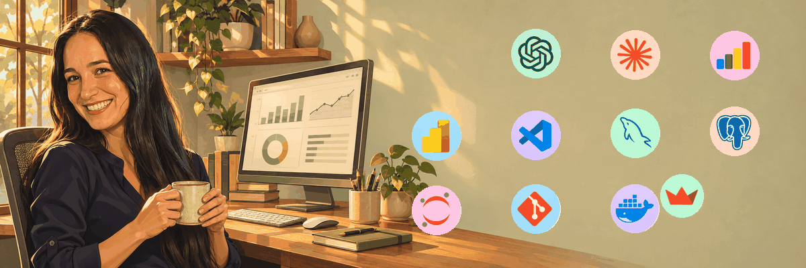

# AI Engineer | Machine Learning | Data Scientist | Business Intelligence

I designed, built, and deployed a Python API that delivers weather data to
Agrodevices’ irrigation platform. I'm currently building RooTime, my master’s
capstone project, which combines soil sensor readings and weather data to
generate explainable irrigation recommendations.

I'm looking for a Junior AI Engineer or Junior Data Scientist role. 

### 🛠️ Tools & Technologies

  
  
  
  
  
  
  
  
  
  
  
  
  
  
  
  
  
  
  
  
  
  
  
  
  
  
  
  
  
  
  
  
  

  

  
  &nbsp;
  
  
  &nbsp;
  
  
  &nbsp;
  
  
  &nbsp;
  
  
  &nbsp;
  
  

## 📂 Featured Projects

### 🌦️ Weather Data Service — Agrodevices

Designed, built, and deployed a Python service that integrates Open-Meteo
with Agrodevices’ irrigation platform. It stores weather data in MySQL and
exposes current conditions, forecasts, and historical data through eight
FastAPI endpoints. I implemented scheduled updates, retries, and logging,
wrote 176 automated tests, and documented the API for the integration team.

**Stack:** Python · FastAPI · MySQL · Open-Meteo · APScheduler · Render

### 🤖 Machine Learning Study Assistant — Gemini & RAG

Built a chat-based study assistant that answers questions about classical
machine learning and neural network fundamentals using five study documents
I wrote. It retrieves relevant passages, cites the sources used in its answers,
and retains conversation context so users can ask follow-up questions.

### 🌱 RooTime — Smart Irrigation

Master’s capstone project in development. RooTime combines soil sensor
readings and weather data to recommend when and how much to irrigate, with
an explanation for each recommendation. The project also includes sensor
anomaly detection and automated daily and weekly reports.

I use Claude Code, OpenSpec, and specialised coding agents to define
requirements, break the work into smaller changes, and review each
implementation against its specification.

### 🏨 Hotel Booking Cancellation Prediction

Built a machine learning model to predict hotel booking cancellations.
I trained on earlier bookings and validated on later ones to reflect how
the model would be used. I excluded features that could leak information
unavailable at prediction time.

### 💬 Employee Reviews NLP Analysis

Analysed employee reviews from Deutsche Bank, Barclays, Citi, and HSBC.
I combined sentiment analysis with BERTopic to identify recurring themes
and compare how employees described their experiences across the four banks.

### 📊 Social Media Performance

Built a Power BI project to analyse social media performance. I designed
the relational database that supports the analysis, from structuring the
source data to making it available for reporting in Power BI.

## 🛠️ Technical Skills

- **Generative AI Integration** 
- **Machine Learning**
- **Natural Language Processing** 
- **Retrieval-Augmented Generation (RAG)** 
- **Data Engineering & Database Design** 
- **Data Analysis & EDA** 
- **Data Visualisation & Storytelling** 
- **Database Querying** 
- **Business Intelligence** 
- **Model Fine-Tuning** — (Currently learning) 
- **MLOps Fundamentals** 

## 🌱 Currently Learning

**Data & Analytics**
- **Advanced SQL & Data Modelling** — Deepening my understanding of complex queries, relational database design and analytical data models.
- **Business Intelligence** — Improving dashboard design, KPI definition and data storytelling to support business decisions.
- **Data Engineering** — Learning to build ETL pipelines that extract, clean, transform and load data for analysis.
- **Statistics & Machine Learning** — Strengthening statistical reasoning, feature engineering and model evaluation.

**AI & Development**
- **MLOps** — Exploring reproducible ML workflows, experiment tracking, model versioning and deployment.
- **Model Fine-Tuning** — Learning how to adapt pretrained models to specific tasks using techniques such as LoRA.
- **Advanced RAG & AI Agents** — Exploring retrieval strategies, response evaluation and assistants that use tools.
- **AI-Assisted Development** — Applying specification-driven workflows and specialised coding agents to build maintainable applications.
- 

## 📫 Connect with Me

## 📫 Connect with Me

