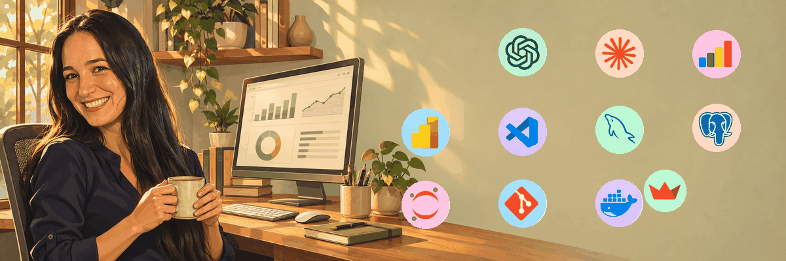

# IA Engineer Junior/ Data Science / MLOps 👋

I am currently developing practical skills in Data Science, Machine Learning, and Artificial Intelligence through academic and personal projects.
My goal is to start my professional career as a Data Analyst or Data Scientist, contributing to real-world projects while continuing to learn and grow within the data and AI ecosystem.

### 🛠️ Tools & Technologies

  
  
  
  
  
  
  
  
  
  
  
  
  
  
  
  
  
  
  
  
  
  
  
  
  
  
  
  
  
  
  
  
  

  
  &nbsp;
  
  
  &nbsp;
  
  
  &nbsp;
  
  
  &nbsp;
  
  
  &nbsp;
  
  

## 🛠️ Technical Skills

- **Generative AI Integration** — Connecting language models to applications, designing prompts and processing structured outputs.
- **Machine Learning** — Preparing data, engineering features, training classification and regression models, and evaluating their performance.
- **Natural Language Processing** — Analysing text through sentiment analysis, text classification and topic modelling.
- **Retrieval-Augmented Generation (RAG)** — Building document-based assistants using embeddings, vector search and contextual retrieval.
- **Data Engineering & Database Design** — Designing and building relational databases, defining table relationships and preparing data for analysis and BI reporting.
- **Data Analysis & EDA** — Cleaning, transforming and exploring data to identify patterns, investigate questions and communicate findings.
- **Data Visualisation & Storytelling** — Turning analytical results into clear visual explanations and actionable insights.
- **Database Querying** — Extracting, joining and aggregating data from relational databases.
- **Business Intelligence** — Defining KPIs and building interactive dashboards to support business decisions.
- **Model Fine-Tuning** — (Currently learning) Exploring how to adapt pretrained models to specific tasks, including parameter-efficient methods such as LoRA.
- **MLOps Fundamentals** — Learning to build reproducible ML workflows, track experiments, version models and deploy prediction services.

## 📂 Featured Projects

### 📊 Personal Expenses Analysis

Exploratory Data Analysis project focused on understanding spending habits and identifying financial patterns using Python.

### 🚗 Madrid Road Accident Analysis

EDA and Logistic Regression project exploring accident trends and risk factors in Madrid.

### 🍽️ Tripadvisor Spain Restaurant Analysis

Data exploration project analyzing restaurant ratings, popularity, and customer satisfaction across Spain.

### ✅ Task Manager Application

Python-based task management application developed to practice object-oriented programming and software development fundamentals.

## 🌱 Currently Learning

* Machine Learning
* Generative AI
* MLOps Fundamentals
* Advanced Data Visualization

## 📫 Connect with Me

LinkedIn: www.linkedin.com/in/laiaromeramacias-datascience

GitHub: github.com/LaiaRomera
